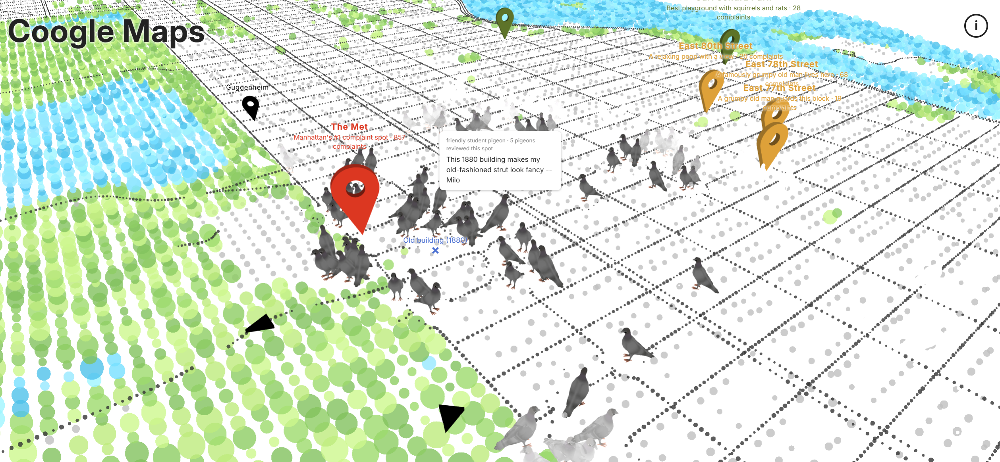

# Coogle Maps

*Coogle Maps* reimagines Manhattan from the pigeons' point of view. NYC 311 complaints about pigeons become fictional place reviews grounded in nearby restaurants, parks, buildings, water, public spaces, and other open data.



The project uses a watercolor-like point cloud inspired by [*Watercolor Style Sketching with Point Cloud*](https://sketchfab.com/3d-models/watercolor-style-sketching-with-point-cloud-6949373156ac4509819f10166b77b91f). Pigeons walk near the complaint locations they represent. Clicking a pigeon opens its review and marks the open-data places referenced by the text. Layered pigeon sounds become fuller near landmarks and complaint hotspots.

## Experience

- Click the ground to move there.
- Drag to rotate the view.
- Click a pigeon to read its review.
- Click once anywhere to enable sound.
- Open the ⓘ panel to see the data behind the map.

Two types of pins support navigation. Small black pins show familiar tourist landmarks, while colored pins identify the twenty locations with the most pigeon complaints and display pigeon-style descriptions written for the project.

## How it works

### Mapbox vector tiles to point cloud

[Mapbox Streets v8](https://docs.mapbox.com/data/tilesets/reference/mapbox-streets-v8/) provides geographic geometry and metadata rather than a finished image. Buildings, parks, and water are polygons; roads are mainly lines.

The point-cloud builder:

1. downloads the vector tiles covering Manhattan;
2. clips them to the Manhattan boundary and rotates the street grid by 29 degrees;
3. samples a regular grid every 25 meters;
4. classifies each sample as building, park, water, or ground;
5. uses building-height metadata to give the cloud depth; and
6. samples roads directly along their lines about every eight meters.

The output is stored in `data/points.bin` and rendered with plain WebGL. See [Mapbox's introduction to vector tiles](https://docs.mapbox.com/data/tilesets/guides/vector-tiles-introduction/) and [`tools/build-points.mjs`](tools/build-points.mjs).

### Pigeons, reviews, and sound

The complaints are grouped into a 150-meter grid. Nearby environmental records are attached to each location and used to prepare grounded review prompts. Each pigeon alternates between randomly timed walking and resting periods; a sine function creates individual steps and body lift, while a home position keeps it close to its data location.

The `pigeon-map-comment-writer` Codex skill defines the review style, realistic pigeon behavior, data-grounding rules, and JSON output. GPT-5 generated 3,630 reviews within this system. A review includes a feature ID only when it uses that record, allowing the interface to reveal its sources.

One pigeon recording is arranged into six possible Web Audio layers. Quiet streets usually retain one voice; additional layers fade, swell, and move across the stereo field near landmarks.

## Run locally

Serve the folder through a local web server:

```bash
python -m http.server 8000
```

Then open `http://localhost:8000`. Opening `index.html` directly will not load the data files.

The included processed files are ready to display. Rebuilding the point cloud requires Node.js, the packages in `package.json`, and a Mapbox token stored as `MAPBOX_TOKEN` in a local `.env` file.

## Data

| Dataset | Source | Manhattan records |
|---|---|---:|
| 311 pigeon complaints, 2010-2026 | NYC Open Data | 4,772 |
| Restaurant inspections | NYC Open Data | 12,270 |
| Litter baskets | NYC Open Data | 8,091 |
| Buildings (PLUTO) | NYC Open Data | 40,050 |
| Parks | NYC Open Data | 396 |
| Public places (CommonPlace) | NYC Open Data | 5,830 |
| Cafés, benches, and fountains | OpenStreetMap | ~39,500 |
| Streets, buildings, water, and parks | Mapbox Streets v8 | 139 tiles |
| Manhattan boundary | OpenStreetMap / Nominatim | 1 |

Complaint counts are real, but the onscreen pigeons are visual representatives rather than a census of birds. The records show where people made 311 reports, not the exact distribution of pigeons. The Metropolitan Museum of Art accounts for 747 of the 4,772 complaints and remains visible as an unusual feature of the source data.

## Project structure

| Path | Purpose |
|---|---|
| `index.html`, `sketch.js`, `css/style.css` | WebGL application and interface |
| `tools/build-points.mjs` | Mapbox vector-tile to point-cloud builder |
| `script/build_cells.py` | Complaint grouping, nearby-place matching, and prompt preparation |
| `script/generate_comments.md` | Batch execution and validation instructions |
| `script/merge_comments.py` | Merges cells and reviews into `data/pigeons.json` |
| `data/hotspots.json` | Top twenty complaint hotspots |
| `data/landmarks.json` | Tourist landmarks used for orientation |
| `grounded-pigeon.obj`, `pigeon.mp3` | Pigeon model and sound asset |
| `AI-ONE-PAGE.md` | Development process and AI-use summary |

The raw city datasets are stored separately and are not included in this repository.

## Development process and AI tools

The project began with a design document, selected datasets, visual references, and a simple p5.js prototype. Claude Code was then used to modify the prototype, explore technical approaches, implement most remaining features, process data, and debug the application. Approximately 90% of the final code was produced through this AI-assisted coding workflow.

The review system was designed as a reusable Codex skill and revised from v2 through v8. GPT-5 generated the individual reviews under its language, behavior, grounding, and traceability rules. The project concept, initial prototype, data selection, design direction, writing rules, testing, and final decisions were developed by the artist. See [`AI-ONE-PAGE.md`](AI-ONE-PAGE.md) for the concise process record.

## Credits

Map data © Mapbox © OpenStreetMap contributors. City data comes from NYC Open Data.

Visual reference: [*Watercolor Style Sketching with Point Cloud*](https://sketchfab.com/3d-models/watercolor-style-sketching-with-point-cloud-6949373156ac4509819f10166b77b91f).

---

# 中文說明

## 專案介紹

*Coogle Maps* 從鴿子的視角重新想像曼哈頓。人類向 NYC 311 提交的鴿子投訴，被轉化成鴿子對城市地點留下的虛構評論；評論內容以附近的餐廳、公園、建築、水域、公共空間及其他開放資料為依據。

地圖使用水彩感的點雲視覺。鴿子在其所代表的投訴地點附近活動；點擊鴿子可閱讀評論，並看見該評論引用的開放資料位置。接近地標與投訴熱點時，鴿子聲音會逐漸增加並形成群聚感。

## 操作方式

- 點擊地面移動。
- 拖曳以旋轉視角。
- 點擊鴿子閱讀評論。
- 首次點擊畫面以啟用聲音。
- 點擊 ⓘ 查看資料來源與統計。

小型黑色圖釘顯示熟悉的觀光地標，協助辨認方向；彩色圖釘則標示鴿子投訴數最高的二十個地點，並附上為專案撰寫的鴿子式說明。

## 技術方法

Mapbox Streets v8 提供建築、公園與水域 polygon，以及道路 line。程式在曼哈頓上建立每 25 公尺一點的網格，判斷每個點落在哪一種 polygon 內，並依類別設定外觀；建築點另外使用高度資料。道路則沿線約每八公尺取樣，使街道保持連續，最後以 WebGL 呈現點雲。

鴿子會在隨機長度的行走與休息狀態之間切換。行走時以 sine function 產生分段前進與身體抬升的效果，並透過 home position 留在其資料地點附近。

評論由 `pigeon-map-comment-writer` Codex skill 規範語氣、鴿子行為、資料引用與 JSON 格式，再由 GPT-5 生成 3,630 則文字。評論只有在實際使用某筆地點資料時才會記錄該 feature ID，因此介面能標出文字所引用的來源。

## AI 製作流程

專案先完成設計文件、資料選擇、視覺參考與簡單的 p5.js prototype，之後使用 Claude Code 修改原型、比較技術方法、完成多數功能、處理資料與除錯；最終程式碼約有 90% 透過此 AI-assisted coding 流程產生。

Codex skill 從 v2 調整至 v8，GPT-5 依照其中的語言、行為、資料限制與可追溯規則生成個別評論。作品概念、初始 prototype、資料選擇、設計方向、寫作規則、測試與最終決策由創作者完成。簡要紀錄請見 [`AI-ONE-PAGE.md`](AI-ONE-PAGE.md)。
